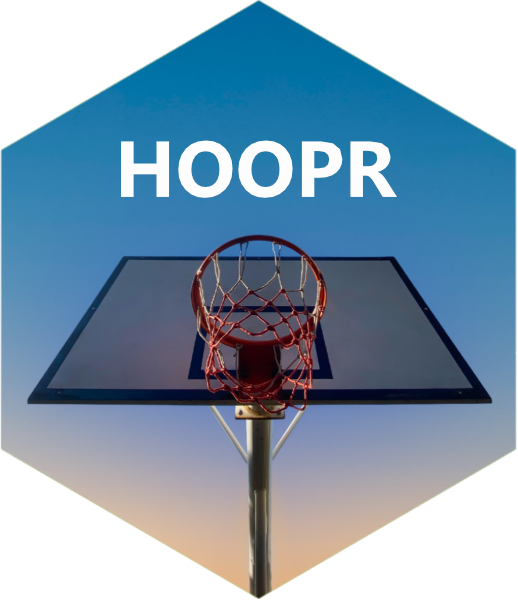
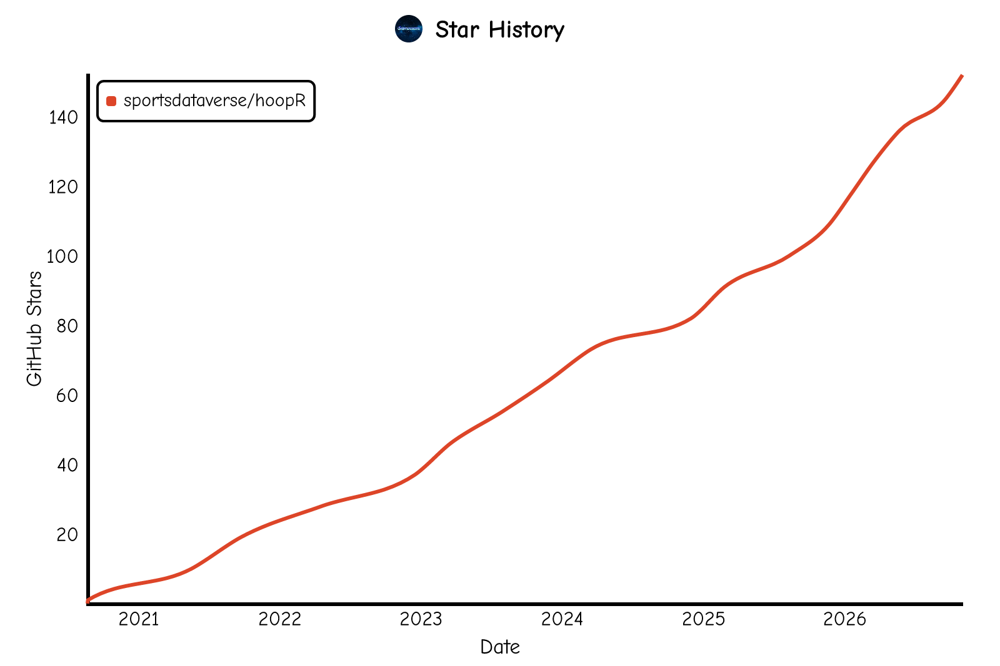

  - [hoopR
    <a href='https://hoopR.sportsdataverse.org/'></a>](#hoopr-)
      - [**Data status**](#data-status)
      - [**Installation**](#installation)
      - [**Quick start**](#quick-start)
      - [**Documentation**](#documentation)
      - [**Breaking Changes**](#breaking-changes)
      - [**Companion packages**](#companion-packages)
      - [**The SportsDataverse**](#the-sportsdataverse)
      - [**Follow the SportsDataverse on X and star this repo**](#follow-the-sportsdataverse-on-x-and-star-this-repo)
      - [**Our Authors**](#our-authors)
      - [**Our Contributors (they're awesome)**](#our-contributors-theyre-awesome)
      - [**Cheat sheet**](#cheat-sheet)
      - [**Code of Conduct**](#code-of-conduct)
      - [**Citations**](#citations)
      - [**License**](#license)

# **hoopR** <a href='https://hoopR.sportsdataverse.org/'></a>

<!-- badges: start -->
[](https://CRAN.R-project.org/package=hoopR)
[](https://CRAN.R-project.org/package=hoopR)
[](https://sportsdataverse.r-universe.dev/hoopR)
[](https://github.com/sportsdataverse/hoopR/)
[](https://github.com/sportsdataverse/hoopR/actions/workflows/R-CMD-check.yaml)
[](https://app.codecov.io/gh/sportsdataverse/hoopR)
[](https://github.com/sportsdataverse/hoopR/actions/workflows/pkgdown.yaml)
[](https://lifecycle.r-lib.org/articles/stages.html#stable)
[](https://github.com/sportsdataverse/hoopR/blob/main/LICENSE.md)
[](https://github.com/sportsdataverse/hoopR/graphs/contributors)
[](https://github.com/sportsdataverse/hoopR/stargazers)
[](https://x.com/SportsDataverse)
[](https://x.com/saiemgilani)
<!-- badges: end -->

The goal of [**`hoopR`**](https://hoopR.sportsdataverse.org/) is to provide tools for
working with men’s basketball data.

It exports more than 1,300 functions:

  - **NBA:** the NBA Stats API (`nba_*`, about 200 functions), ESPN
    (`espn_nba_*`), the NBA G League (`nbagl_*`), Basketball-Reference
    (`bref_*`), RealGM (`realgm_*`), Fox Sports (`fox_nba_*`),
    official.nba.com officiating reports (`nba_l2m()`,
    `nba_referee_assignments()`), salary and mock-draft sources, and
    cross-source crosswalks.
  - **Men’s college basketball:** ESPN (`espn_mbb_*`), Ken Pomeroy’s
    [kenpom.com](https://kenpom.com/) (`kp_*`, for users with an active
    subscription), CollegeBasketballData (`cbbd_*`), Bart Torvik
    (`torvik_*`), the NCAA (`ncaa_mbb_*`) and Fox Sports (`fox_mbb_*`).
  - **International:** EuroLeague and EuroCup (`euroleague_*`) and about
    two dozen leagues and competitions, among them FIBA events
    (`fiba_*`), Spain’s ACB (`acb_*`), Italy’s LBA (`lba_*`), the VTB
    United League (`vtb_*`), Japan’s B.LEAGUE (`bleague_*`), Australia’s
    NBL (`nbl_rosetta_*`), Korea’s KBL (`kbl_*`) and China’s CBA
    (`cba_*`). See the [function
    reference](https://hoopR.sportsdataverse.org/reference/) for the
    full list.
  - **Loaders:** `load_nba_*()`, `load_mbb_*()`, `load_nba_stats_*()`
    and `load_ncaa_mbb_*()` read pre-built play-by-play, box score,
    schedule, shot and model data from the `sportsdataverse-data`
    releases.

## **Data status**

The `load_*()` functions read release assets on
[sportsdataverse-data](https://github.com/sportsdataverse/sportsdataverse-data/releases).
The badges below are rebuilt nightly from each producer’s latest
workflow run and newest release files; idle means the sport is out of
season. Full detail:
[sportsdataverse.org/status](https://sportsdataverse.org/status).

| Dataset                                                                                              | Data updated                                                                                                                                                                                                                                                                     | Through                                                                                                                                                                                                                                                                            | Pipeline                                                                                                                                                                                                                                                                 | Update workflows                                                                                                                                                                                                                                                                                                                                                                                                                                                                                                                                                                                                                                                                                                                                                                                                                                                                                                                                                                                |
| :--------------------------------------------------------------------------------------------------- | :------------------------------------------------------------------------------------------------------------------------------------------------------------------------------------------------------------------------------------------------------------------------------- | :--------------------------------------------------------------------------------------------------------------------------------------------------------------------------------------------------------------------------------------------------------------------------------- | :----------------------------------------------------------------------------------------------------------------------------------------------------------------------------------------------------------------------------------------------------------------------- | :---------------------------------------------------------------------------------------------------------------------------------------------------------------------------------------------------------------------------------------------------------------------------------------------------------------------------------------------------------------------------------------------------------------------------------------------------------------------------------------------------------------------------------------------------------------------------------------------------------------------------------------------------------------------------------------------------------------------------------------------------------------------------------------------------------------------------------------------------------------------------------------------------------------------------------------------------------------------------------------------- |
| [Men’s college basketball (ESPN)](https://github.com/sportsdataverse/hoopR-mbb-data)                 | [](https://github.com/sportsdataverse/sportsdataverse-data/releases)             | [](https://github.com/sportsdataverse/sportsdataverse-data/releases)             | [](https://sportsdataverse.org/status#hoopR-mbb-data)                   | [](https://github.com/sportsdataverse/hoopR-mbb-data/actions/workflows/daily_mbb.yml) [](https://github.com/sportsdataverse/hoopR-mbb-data/actions/workflows/mbb_models_cron.yml)                                                                                                                                                                                                                                                                                                                                                                                            |
| [Men’s college basketball (stats.ncaa.org)](https://github.com/sportsdataverse/ncaa-mbb-hoops-data)  | [](https://github.com/sportsdataverse/sportsdataverse-data/releases)   | [](https://github.com/sportsdataverse/sportsdataverse-data/releases)   | [](https://sportsdataverse.org/status#ncaa-mbb-hoops-data)    | [](https://github.com/sportsdataverse/ncaa-mbb-hoops-data/actions/workflows/ncaa_mbb_models.yml)                                                                                                                                                                                                                                                                                                                                                                                                                                                                                                                                                                                                                                                                      |
| [NBA (ESPN)](https://github.com/sportsdataverse/hoopR-nba-data)                                      | [](https://github.com/sportsdataverse/sportsdataverse-data/releases)             | [](https://github.com/sportsdataverse/sportsdataverse-data/releases)             | [](https://sportsdataverse.org/status#hoopR-nba-data)                   | [](https://github.com/sportsdataverse/hoopR-nba-data/actions/workflows/daily_nba.yml)                                                                                                                                                                                                                                                                                                                                                                                                                                                                                                                                                                                                                                                                                                        |
| [NBA Stats API](https://github.com/sportsdataverse/hoopR-nba-stats-data)                             | [](https://github.com/sportsdataverse/sportsdataverse-data/releases) | [](https://github.com/sportsdataverse/sportsdataverse-data/releases) | [](https://sportsdataverse.org/status#hoopR-nba-stats-data) | [](https://github.com/sportsdataverse/hoopR-nba-stats-data/actions/workflows/daily_nba_stats.yml) [](https://github.com/sportsdataverse/hoopR-nba-stats-data/actions/workflows/nba_models.yml) [](https://github.com/sportsdataverse/hoopR-nba-stats-data/actions/workflows/annual_nba_stats_draft.yml) |
| [Conference, division and ballpark reference](https://github.com/sportsdataverse/sdv-reference-data) | [](https://github.com/sportsdataverse/sportsdataverse-data/releases)     | [](https://github.com/sportsdataverse/sportsdataverse-data/releases)     | [](https://sportsdataverse.org/status#sdv-reference-data)       | —                                                                                                                                                                                                                                                                                                                                                                                                                                                                                                                                                                                                                                                                                                                                                                                                                                                                                                                                                                                               |

## **Installation**

You can install the CRAN version of
[**`hoopR`**](https://CRAN.R-project.org/package=hoopR) with:

``` r
install.packages("hoopR")
```

You can install the latest build from [R-universe](https://sportsdataverse.r-universe.dev/hoopR) with:

```r
install.packages("hoopR", repos = c("https://sportsdataverse.r-universe.dev", getOption("repos")))
```

You can install the development version of [**`hoopR`**](https://github.com/sportsdataverse/hoopR/) from GitHub with:

```r
if (!requireNamespace("pak", quietly = TRUE)) install.packages("pak")
pak::pak("sportsdataverse/hoopR")
# or: remotes::install_github("sportsdataverse/hoopR")
```

## **Quick start**

### **NBA play-by-play for a season**

`load_nba_pbp()` covers 2002-2027; pass several seasons (or `seasons
= 2002:2026`) to load more at once.

``` r
nba_pbp <- hoopR::load_nba_pbp(seasons = 2026)
```

    ## 642472 rows of NBA play-by-play data from 1325 games.

### **Men’s college basketball play-by-play for a season**

`load_mbb_pbp()` covers 2006-2027.

``` r
mbb_pbp <- hoopR::load_mbb_pbp(seasons = 2026)
```

    ## 2915731 rows of men's college basketball play-by-play data from 6275 games.

## **Documentation**

For more information on the package and function reference, please see
the [**`hoopR`** documentation
website](https://hoopR.sportsdataverse.org).

- [Function reference](https://hoopR.sportsdataverse.org/reference/index.html)
- Vignettes:
  - [Getting Started with hoopR: NBA and College Basketball Data in R](https://hoopR.sportsdataverse.org/articles/getting-started-hoopR.html)
  - [CollegeBasketballData (CBD) Endpoints](https://hoopR.sportsdataverse.org/articles/cbbd-college-basketball-data.html)
  - [ESPN basketball endpoints – NBA & MBB](https://hoopR.sportsdataverse.org/articles/espn-endpoints.html)
  - [KenPom Example Functions](https://hoopR.sportsdataverse.org/articles/kenpom-example-functions.html)
  - [Men's College Basketball Cookbook](https://hoopR.sportsdataverse.org/articles/mbb-cookbook.html)
  - [NBA Cookbook](https://hoopR.sportsdataverse.org/articles/nba-cookbook.html)
  - [NBA Stats API Parameter Descriptions](https://hoopR.sportsdataverse.org/articles/parameter-descriptions.html)
- Articles:
  - [Basketball Advanced Metrics in R: Possessions, Pace, Ratings and the Four Factors](https://hoopR.sportsdataverse.org/articles/basketball-advanced-metrics.html)
  - [College Basketball Player Value Model: Box Plus-Minus for NCAA Men's Players](https://hoopR.sportsdataverse.org/articles/college-basketball-player-value-model.html)
  - [College Basketball RAPM Model: Regularized Adjusted Plus-Minus for NCAA Men's Players](https://hoopR.sportsdataverse.org/articles/college-basketball-rapm-model.html)
  - [College Basketball Team Ratings Model: Opponent-Adjusted Efficiency for NCAA Men's Teams](https://hoopR.sportsdataverse.org/articles/college-basketball-team-ratings-model.html)
  - [College Basketball Win Probability Model: In-Game Win Probability in hoopR Play-by-Play](https://hoopR.sportsdataverse.org/articles/college-basketball-win-probability-model.html)
  - [International Basketball Data in R: EuroLeague, FIBA and 40+ Leagues with hoopR](https://hoopR.sportsdataverse.org/articles/international-basketball-leagues.html)
  - [NBA and College Basketball Shot Charts in R with hoopR, sportyR and sdvplotR](https://hoopR.sportsdataverse.org/articles/nba-college-basketball-shot-charts.html)
  - [NBA Player Impact Model: RAPM, SPM, BPM, DARKO-Style Projections and WAR](https://hoopR.sportsdataverse.org/articles/nba-player-impact-model.html)
- [News and release notes](https://hoopR.sportsdataverse.org/news/index.html)

There is also a printable [**`hoopR` cheat sheet
(PDF)**](https://sportsdataverse.org/cheatsheets/hoopR.pdf), one of [a
set covering every SportsDataverse
package](https://sportsdataverse.org/cheatsheets).

## **Breaking Changes**

[**Full News on
Releases**](https://hoopR.sportsdataverse.org/news/index.html)

## **Companion packages**

  - [**`sdvplotR`**](https://sdvplotR.sportsdataverse.org/) (0.3.0,
    `pak::pak("sportsdataverse/sdvplotR")`) adds team logos and colours
    to `ggplot2` charts and draws shot charts from the `hoopR` shot
    loaders; see its
    [NBA](https://sdvplotR.sportsdataverse.org/articles/nba-viz.html),
    [men’s
    college](https://sdvplotR.sportsdataverse.org/articles/mbb-viz.html)
    and [shot
    chart](https://sdvplotR.sportsdataverse.org/articles/cookbook-surfaces-shot-charts.html)
    articles.
  - [**`sportyR`**](https://sportyR.sportsdataverse.org/) (2.4.5,
    `install.packages("sportyR")`) draws NBA, NCAA and FIBA courts to
    plot shot locations on.
  - [**`wehoop`**](https://wehoop.sportsdataverse.org/) is the women’s
    basketball companion (WNBA and women’s college basketball).
  - [**`sportsdataverse-py`**](https://py.sportsdataverse.org/) is the
    Python package; most `hoopR` functions have a Python twin of the
    same name.

## **The SportsDataverse**

[**`hoopR`**](https://hoopR.sportsdataverse.org/) is part of the [SportsDataverse](https://sportsdataverse.org/), a set of
open-source packages for sports data.

| Package | Sport / Scope |
|---|---|
| [**cfbfastR**](https://cfbfastR.sportsdataverse.org/) | College football |
| [**hoopR**](https://hoopR.sportsdataverse.org/) | Men's basketball (NBA and NCAA) |
| [**wehoop**](https://wehoop.sportsdataverse.org/) | Women's basketball (WNBA and NCAA) |
| [**fastRhockey**](https://fastRhockey.sportsdataverse.org/) | Hockey (NHL and PWHL) |
| [**baseballr**](https://billpetti.github.io/baseballr/) | Baseball (MLB, MiLB, NCAA) |
| [**softballR**](https://github.com/sportsdataverse/softballR) | College softball |
| [**oddsapiR**](https://oddsapiR.sportsdataverse.org/) | Sports betting odds |
| [**recruitR**](https://recruitR.sportsdataverse.org/) | College football recruiting |
| [**usfootballR**](https://usfootballR.sportsdataverse.org/) | US soccer |
| [**cfbseedR**](https://cfbseedR.sportsdataverse.org/) · [**cfb4th**](https://cfb4th.sportsdataverse.org/) | CFB playoff simulation · fourth-down decisions |
| [**cfbplotR**](https://cfbplotR.sportsdataverse.org/) · [**sdvplotR**](https://sdvplotR.sportsdataverse.org/) · [**sportyR**](https://sportyR.sportsdataverse.org/) | Logos, colors, tables · playing surfaces |
| [**sportsdataverse-R**](https://r.sportsdataverse.org/) | Umbrella R metapackage |
| [**sportsdataverse-py**](https://py.sportsdataverse.org/) · [**sportsdataverse.js**](https://js.sportsdataverse.org/) | Python and Node.js |

See the full ecosystem at [sportsdataverse.org](https://sportsdataverse.org/).

## **Follow the [SportsDataverse](https://x.com/SportsDataverse) on X and star this repo**

[](https://x.com/SportsDataverse)

[](https://github.com/sportsdataverse/hoopR)

<a href="https://github.com/sportsdataverse/hoopR"> <picture>
<source media="(prefers-color-scheme: dark)" srcset="https://raw.githubusercontent.com/sportsdataverse/hoopR/star-history/star-history-dark.svg">

</picture> </a>

## **Our Authors**

  - Saiem Gilani (@saiemgilani)
    <a href="https://x.com/saiemgilani" target="blank"></a>

<a href="https://github.com/saiemgilani" target="blank"></a>

## **Our Contributors (they're awesome)**

  - Jason Lee (@theFirmAISports)
    <a href="https://x.com/theFirmAISports" target="blank"></a>
    <a href="https://github.com/papagorgio23" target="blank"></a>

  - Billy Fryer

  - Ross Drucker (@rossdrucker9)
    <a href="https://x.com/rossdrucker9" target="blank"></a>
    <a href="https://github.com/rossdrucker" target="blank"></a>

  - Vladislav Shufinskiy (@vshufinskiy)
    <a href="https://x.com/vshufinskiy" target="blank"></a>
    <a href="https://github.com/shufinskiy" target="blank"></a>

<!-- cheatsheet-section -->

## **Cheat sheet**

A printable one-page reference for **`hoopR`** — the function families,
the loaders, and what each one returns.

📄 **[Download the hoopR cheat sheet
(PDF)](https://sportsdataverse.org/cheatsheets/hoopR.pdf)**

Free to download, print and hand out; light and dark, US Letter
landscape. Every SportsDataverse package has one — browse them all at
**[sportsdataverse.org/cheatsheets](https://sportsdataverse.org/cheatsheets)**.

## **Code of Conduct**

Please note that the hoopR project is released with a [Contributor Code of Conduct](https://hoopR.sportsdataverse.org/CODE_OF_CONDUCT.html).
By contributing to this project, you agree to abide by its terms.

## **Citations**

To cite the [**`hoopR`**](https://hoopR.sportsdataverse.org) R package
in publications, use:

BibTeX Citation

``` bibtex
@misc{gilani_2021_hoopR,
  author = {Gilani, Saiem},
  title = {hoopR: Access Men's Basketball Play by Play Data},
  url = {https://hoopR.sportsdataverse.org},
  doi = {10.32614/CRAN.package.hoopR},
  year = {2026}
}
```

## **License**

[**`hoopR`**](https://hoopR.sportsdataverse.org/) is released under the MIT License (`MIT + file LICENSE`); see [LICENSE.md](https://github.com/sportsdataverse/hoopR/blob/main/LICENSE.md).
